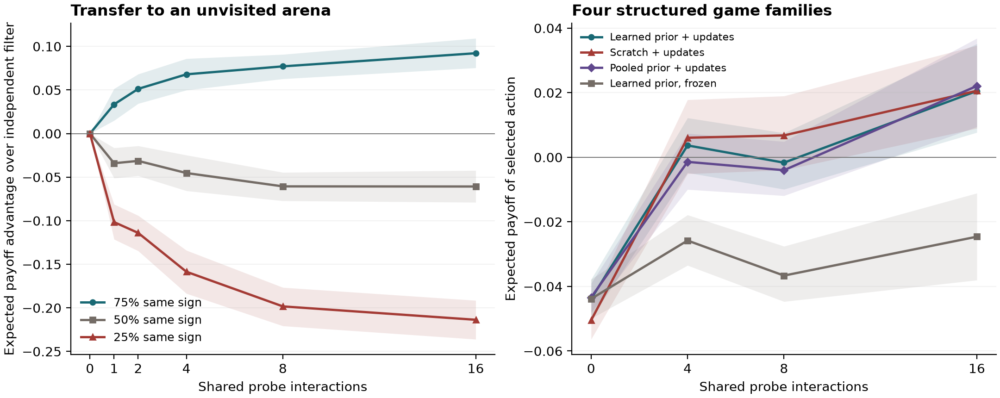

# When does experience in a new game improve the next decision?

The follow-up studies relate rule similarity to measured adaptation and resume the full D-031 budget from its sealed archive. The original exploratory reward-stakes protocol has also been executed and verified. [Similarity results and reproduction](rule_similarity/REPORT.md) · [D-031 continuation](d031_completion/README.md) · [Reward-stakes experiment](probe_stakes/REPORT.md)

**Direct test of the central question.** A subsequent study crossed focal meta-training versus ordinary pretraining with counterpart learning enabled versus disabled. On 3,072 new structured games, eight observations improved both agents. Their payoff difference against a learning counterpart was −0.00015 [−0.00312, +0.00271], and changing counterpart learning produced an unresolved three-way interaction of +0.00013 [−0.00390, +0.00423]. These 97.5% intervals account for the two primary comparisons. A separate planning study found a small two-turn planning benefit and an unresolved reward-information mechanism. [Matched meta-training and counterpart-learning study](opponent_adaptation/REPORT.md) · [Two-turn planning study](active_probe/REPORT.md)

**Finding.** A population prior learned across games helped an agent use four observations from one context to respond in an unvisited context when its opponent's incentives tended to agree across contexts. Reversing that relationship made the same prior harmful. In the supplied structured games, learning a reward prior improved the initial decision, but a scratch learner improved more over eight observations. The experiments support a specific mechanism for transfer and expose a case where online learning does most of the work.

Left: advantage of the prior trained with 75% concordant incentives over an equally informed within-arena filter. The three lines reweight the same test games. Right: absolute expected reward in the four generated game families, under common histories and opponent states. Shading gives descriptive pointwise 95% bootstrap intervals over independent catalog/test blocks. The tables below give the prespecified primary intervals.

## 1. Isolate transfer of information before allowing policies to change the opponent

In each new two-arena game the focal player generally wants to match the opponent, with a small public action bonus. The opponent privately favors either coordination or anti-coordination in each arena. It learns a recency-weighted belief about focal actions and uses a smooth best response. Both signs are marginally fair. The training population varies how often the two signs agree, denoted by q. If q=.5, observing behavior in one arena gives no information about the other sign. If q>.5, evidence about the first sign predicts the second. The two cases have identical zero-shot optimal actions. This makes an otherwise invisible population regularity experimentally identifiable.

We estimated sign concordance and the prevalence of fast opponent updates from grouped, unlabeled training trajectories. At test, Bayesian filtering over eight candidate types used joint actions. The independent baseline used the same likelihood, information and updates, with a factorized prior. Other controls included a frozen prior, same-data pooled logistic prediction, online frequency estimation, a known population prior and a privileged known-type decision. The controller optimizes immediate reward. A correct likelihood and representation are supplied by the researcher. [Frozen protocol](adapt_v1/PROTOCOL.md) · [Design alternatives and primary literature](adapt_v1/DESIGN_REVIEW.md)

Training crossed 32 or 128 distinct games, three levels of concordance and two learning-rate populations. Each arm received 2,048 turns and 80 mixture-fit iterations. More games meant fewer resets per game. The matched 128-game fit recovered mean q=.749 and fast fraction=.506 across catalogs. In each of 32 independent blocks, every method was queried against the same 64 new games and the same realized opponent state after each common probe history. Deployment separately gave every policy its own 32-turn interaction. Shifted dynamics used paired games in which the opponent maintained distinct beliefs for each arena.

| Prespecified contrast at four probes in the unvisited arena | Payoff difference | 97.5% block-bootstrap interval |
|---|---:|---:|
| Learned .75-concordance prior minus independent filter, deployed at q=.75 | +0.0680 | [+0.0464, +0.0887] |
| Balanced-sign training minus always-concordant training, deployed at q=.50 | +0.0535 | [+0.0296, +0.0774] |

Both endpoints subtract each method's zero-probe value. The compared methods made identical decisions at zero probes, so these estimates also equal the absolute differences at four. The two nominal 97.5% intervals implement a Bonferroni adjustment within this study. [Per-block estimates](evidence/cross_context_blocks.csv) · [Primary estimates and intervals](evidence/cross_context_primary.csv)

**Where the advantage came from.** At deployment q=.75, the learned and independent filters scored .7586 and .7585 in the *observed* arena. In the *unvisited* arena they scored .6363 and .5683. A known-population filter scored .6352 there, and the privileged type oracle scored .8160. The corresponding expected Brier scores for learned and independent forecasts were .2293 and .2500. When q was reversed to .25 the same learned controller scored .4111 against .5697 for the independent filter. The strong effect arises precisely where the fitted cross-context relationship governs a decision. At q=.50, balanced training mainly avoided the cost of confidently switching on irrelevant evidence.

**Which training changes mattered.** With q=.75 and mixed speeds, 32 and 128 training games gave .6349 and .6363 on the matched four-probe query at equal total exposure. Training only on slow opponents gave .6187 on fast test opponents, versus .6487 after training on both speeds. With the opponent's true beliefs localized by arena, the main comparison gave .6043 versus .5676. These are descriptive comparisons. They separate the specified interventions while leaving the budget tradeoff between task count and repeats intact. [Full shift curves](evidence/cross_context_curves.png)

**What survived deployment.** Mean realized reward per turn at q=.75 was .7235 for the learned prior, .7140 for the independent filter, .6270 for the frequency learner, .5616 for the frozen prior and .5603 for the pooled predictor. Learned and independent filters averaged .6098 versus .6004 over the first four turns and .7741 versus .7653 over the last four. The opponent's mean signed payoff was .1827 versus .1766 and mean absolute belief was .5414 versus .5340. Different policies induced different trajectories. The smaller deployment gap answers a different question from the advantage at a shared state with no direct query-arena experience.

## 2. Apply an adaptive model to the supplied structured games

We used the actual resource, sequence, reciprocity and mixed generators and their state transitions. Both players chose among three actions. Each test used depth-three history and a tabular Q-learning opponent. At 0, 4, 8 and 16 probe turns, we computed the expected reward of each candidate action against the continuing opponent policy. These hypothetical queries left the persistent game and Q states intact. Separate 32-turn deployments measured realized return. All focal fits used only publicly observable information and focal rewards.

The task-grouped empirical-Bayes model estimated a prior mean over per-game action-reward coefficients. On a new game it updated those coefficients through recursive ridge regression. Pooled pretraining used the same observations and could take exactly the same online updates. Scratch started from zero. A frozen model retained the same fitted coefficients. Sixteen independent blocks each trained a four-motif and a resource-only model, using 32 games and 1,024 turns per arm. The final evaluation contained 512 distinct game specifications balanced across motifs. [Protocol](structured_transfer/PROTOCOL.md) · [Detailed results and deviations](structured_transfer/REPORT.md)

| Controller | Zero probes | Eight probes | Sixteen probes | 32-turn deployed return |
|---|---:|---:|---:|---:|
| Task-grouped prior with updates | −.04385 | −.00167 | .02052 | .992 |
| Same fitted prior, frozen | −.04385 | −.03665 | −.02460 | −.927 |
| Pooled pretraining with updates | −.04339 | −.00400 | .02209 | .948 |
| Scratch with updates | −.05051 | .00677 | .02059 | .889 |

The prespecified learned-minus-scratch difference in improvement from zero to eight probes was **−.01510**, 95% paired block-bootstrap interval **[−.02818, −.00290]**. Scratch began .00666 lower and finished .00844 higher at eight. At that same state, updating the fitted prior beat freezing it by .03498. These quantities distinguish the value of new observations, the starting policy and the choice of training objective. The descriptive mixed-minus-resource-only gain was −.00823 [−.02347, .00681]. The data permit both directions for that diversity comparison. The deployment return includes strategic feedback and the actual downstream state distribution. [Family-specific curves](evidence/structured_curves.csv) · [Deployment outcomes](evidence/structured_deployment.csv)

**Implementation deviation.** The launch protocol overgeneralized the mixed family's three-state and stochastic specification. Resource and reciprocity have one public state, sequence has two, and mixed has two public states plus hidden trust. Only resource and mixed contain stochastic transition gates. For the two single-state motifs the original feature code broadcast that state into two slots, changing effective regularization. All outcomes above retain that encoding. We preserved the opened panel, recovered the exact launch protocol by its recorded SHA-256 and used a fresh protocol for a zero-padded representation and larger games.

## 3. Does the structured generator reward looking ahead?

We used a fresh panel to solve a two-turn decision exactly. The focal player knew two possible same-motif rules with equal prior probability. It observed joint actions and public state. The comparison granted or masked its first realized reward at the second decision. We integrated both opponent actions, the opponent's Q update and any stochastic transition. A second comparison restricted the first action to an immediate-payoff optimum. Compiled current-action reward masks and reachable transition branches avoided enumeration of the entire history space. [Diagnostic protocol](structured_oracle/PROTOCOL.md)

| Actions, history depth | Pairs | Pairs benefiting from seeing first reward | Pairs losing value if first choice must be greedy | Mean reward-observation value |
|---|---:|---:|---:|---:|
| 3, 1 | 96 | 75 | 46 | .01966 |
| 3, 3 | 96 | 73 | 40 | .02048 |
| 6, 5 | 96 | 62 | 24 | .01091 |

In three-action depth-three games, 35 of 96 pairs still lost value under the greedy restriction with the first reward masked. A costly first move can prepare a state, influence the learner, or reveal information through public transitions. Calling all 40 cases costly information gathering would attribute too much to exploration. With six actions, none of the 24 sequence pairs lost value to the greedy restriction in this two-turn opening. The calculation assumes exact payoff observations and a known two-rule library. These are opportunity measurements for the generator, not achieved performance of the trained controller. [All per-pair action values](evidence/two_turn_pairs.json) · [Motif and setting summaries](evidence/two_turn_summary.csv)

## 4. Transfer a fitted model to a larger action space

After opening the first structured study, we specified a separate follow-up with fresh seeds, explicit zero-padding and a representation shared across action labels. Its features include whether a candidate action matches either player's past moves at each lag. Each training game/action group contributes to one shared prior mean. A task-pooled regression sees exactly the same samples. Both controllers update a separate coefficient vector for each available action during the test game. Three-action, depth-three games supply all training data. The same fitted coefficients initialize play in three settings, including six-action, depth-five games. Lags four and five have no learned training signal and can acquire coefficients online. [Follow-up protocol](structured_scale/PROTOCOL.md)

In 384 fresh six-action games across 16 training blocks, expected reward after eight common probes was **.01189** for task-grouped training and **.00813** for pooled training. The prespecified absolute difference was **+.00376**, 95% paired block-bootstrap interval **[+.00071, +.00702]**. The grouped model started lower (−.02371 versus −.02054). By 16 probes the descriptive ordering had reversed (.01478 versus .01697). At eight probes the frozen grouped model scored −.02272 and scratch scored .00898. The small gain from grouping therefore depends on the evaluation budget. One-step reward under the privileged per-state oracle is the comparison target for the query; these numbers are payoffs, not proportions of optimal play. [Primary result](evidence/scale_primary.json) · [All budget and family means](evidence/scale_curves.csv)

Masking public state at evaluation gave .00982 at eight probes; masking lags two through five gave .01081. Both masks reuse the full fitted prior. These are sensitivity tests for that controller, and cannot establish which observations an optimally retrained agent needs. In separate 24-turn six-action rollouts the grouped and pooled controllers earned average totals of .648 and .542. The opponent's accumulated absolute Q changes were .414 and .398. The follow-up also evaluated 384 games each at three actions with depths one and three. Depth, action count, action roles and reachable states can vary together across settings. This design establishes that the fitted model can transfer across these settings, while a causal threshold in game complexity remains open. [Deployment by size and motif](evidence/scale_deployment.csv)

## Interpretation, costs and reproducibility

**H1.** The controlled study identifies a specific diversity effect at fixed experience: training on discordant as well as concordant incentives protects against overgeneralizing a sign relationship. The same training pattern can help or hurt depending on deployment composition. The four-motif study finds no resolved benefit from replacing a resource-only catalog with a balanced catalog on its gain endpoint. Thus both the nuisance variation and the particular relationship being diversified matter.

**H2.** The controlled filter recovers an unknown cross-context regularity and uses it when the query context has never been visited. The cross-size model can use a shared predictor fitted on three-action games. In both cases the representation and update rule were supplied. Discovering a reusable temporal rule, learning which actions to explore, or beating a well-tuned recurrent agent remains an open question. The exact diagnostic supplies settings in which longer-horizon control could matter, including cases where state preparation alone has value.

| Experiment | Training interactions | Evaluation and measured simulation cost |
|---|---:|---|
| Two-arena filter | 786,432 across 384 fits | 2,048 distinct test games with paired global/local dynamics, 20 methods, 32-turn rollouts. 2.14 s wall time with six CPU workers, 11.32 s summed block elapsed time. |
| Structured reward prior | 32,768 | 512 test games, 8,192 common probe turns, 114,688 deployment turns. 13.5 s summed block elapsed time. |
| Two-turn decision audit | 0 | 288 pair/setting decisions. 1.88 s wall time. |
| Structured cross-size | 16,384 | 1,152 game/setting instances, 18,432 common probe turns, 165,888 deployment turns. 14.75 s summed block elapsed time. |

Runtimes are specific to this WSL Linux CPU host and exclude analysis and independent verification. The historical D-031 audit reproduced −.002601 for M−P from the raw records of its first primary model pair. Its opened final games were excluded from all new protocols. New task seeds, priors, numerical simulation/fit outputs, manifests, code hashes and raw interaction records are retained locally. The fresh studies do not complete the historical 25-pair PPO design. [Historical audit](adapt_v1/HISTORICAL_AUDIT.md) · [Reproduction and verification instructions](REPRODUCE.md)
