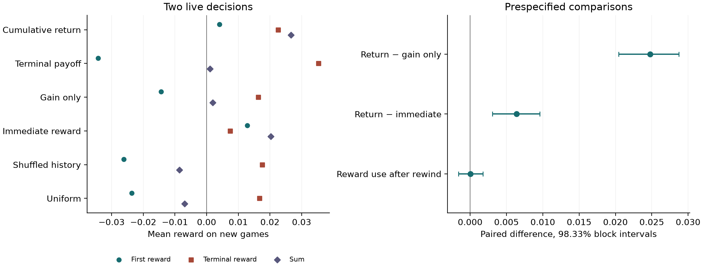

# 탐색과 적응의 보상을 함께 최적화하면 어떤 행동을 고르는가?

새 게임에서 첫 행동과 후속 행동의 **절대 누적 보상**을 목표로 학습시켰다. 기존 방식과 유사하게 관측의 보존·가림 성능 차이를 목표로 학습한 탐색 정책보다 두 턴의 합계가 **0.02476** 높았다. 즉시 보상만 최적화한 정책에 대한 차이는 **0.00638**였다. 상대와 게임의 물리적 상태를 되돌렸을 때는, 누적 보상 정책이 더 유용한 수치 보상 신호를 주는 첫 행동을 골랐는지 판정할 수 없었다.



왼쪽은 첫 보상, 후속 기대 보상과 그 합계다. 오른쪽은 24개 독립 훈련 블록에서 쌍으로 계산한 대비다. 세 대비에 대해 개별 98.33% 구간을 적용했다. [블록별 원자료 집계](evidence/block_payoffs.csv) · [사전 지정 대비](evidence/primary.json)

## 목적함수

고정된 탐색 예산 (K)와 후속 평가 예산 (H)에서는 본 연구 질문에 맞는 기본 목표가 다음과 같다.

[
J_{mathrm{return}} = mathbb E_pi left[sum_{t=1}^{K+H} r_t
ight].
]

탐색 행동의 직접 보상과 그 이후 학습으로 얻는 보상이 모두 들어간다. 여러 탐색 예산에서 학습 후 성능이 중요하다면, (sum_k w_k,mathbb E[V(k)])처럼 사전에 고정한 가중치로 절대 성능 곡선의 면적을 최적화할 수 있다. 예산별 탐색 비용까지 반영하려면 (V(k))에 탐색부터 평가 종료까지의 동일 총예산 누적 보상을 넣는다. 이번 구현은 첫 행동 한 번과 후속 응답 한 번의 누적 보상이다.

(G(a)=V_{mathrm{visible}}(a)-V_{mathrm{masked}}(a))에서 가림 조건의 성능도 첫 행동 (a)에 따라 변한다. 그래서 첫 행동 이후의 절대 보상이 그대로여도 가림 조건의 보상이 떨어지면 (G)가 커진다. 가림 비교가 주는 정보는 진단에 사용했다. D-031의 (G)는 수치 보상 하나를 가리는 대신 학생 Q값을 지운다. D-031 정규 주 실험 25쌍의 원자료를 재계산하면, 무탐색 점수는 두 방법 모두 .14995였고, (K=24)에서 지운 뒤의 평가 보상은 (G)로 훈련한 M .18131, 즉시 보상으로 훈련한 P .17643이었다. 주 적응 면적 차이 M−P는 −.01274, 기존 95% 구간 [−.01608, −.00954]였다. 기존 결과에서 M이 무탐색 성능이나 Q값을 지운 뒤의 성능을 더 낮췄다는 설명은 이 평균으로 뒷받침되지 않는다. [D-031 원자료 재계산](evidence/d031_audit.json)

## 실제 비교

자원, 순서, 상호성, 혼합 구조화 게임의 학습 상대와 네 번 상호작용한 뒤 첫 행동을 고르게 했다. 학습된 네 첫 행동 정책에는 동일한 데이터, 구조와 계산량을 제공했다. 네 목적함수는 누적 보상, 후속 절대 보상, 첫 수치 보상 관측의 보존·가림 차이, 즉시 보상이다. 후속 응답기는 별도 게임에서 먼저 훈련한 같은 모델을 사용했다. 탐색 정책은 관측한 이력과 공개 상태를 보고 행동한다. 실험기는 훈련과 평가에서 모든 첫 행동을 분기하고 상대의 후속 행동 확률로 보상을 계산한다. 접근 가능한 정보와 가림 조건은 [사전 지정 프로토콜](PROTOCOL.md)에 기록했다.

| 첫 행동의 학습 목표 | 첫 보상 | 후속 보상 | 누적 보상 |
|---|---:|---:|---:|
| 누적 보상 | +.00403 | .02263 | **.02666** |
| 후속 절대 보상 | −.03426 | **.03533** | .00107 |
| 관측 보존·가림 차이 | −.01439 | .01629 | .00190 |
| 즉시 보상 | **+.01280** | .00748 | .02028 |
| 같은 계열의 다른 게임 이력을 넣은 누적 보상 정책 | −.02618 | .01761 | −.00857 |
| 균등 무작위 | −.02362 | .01672 | −.00690 |

후속 절대 보상만 최적화하면 가장 높은 후속 성능을 얻었지만 첫 행동 비용도 가장 컸다. 누적 보상 정책도 즉시 보상 정책보다 첫 턴에서 .00877을 덜 얻었고, 다음 턴에서 .01515를 더 얻었다. 두 정책은 31.5%의 시험에서 다른 첫 행동을 선택했다. 게임 계열별 기술 통계에서는 누적 보상 정책의 우위가 상호성 게임에 집중됐다. 자원·순서 게임에서는 즉시 보상 정책의 평균 합계가 더 높았다.

차이 목표의 실시간 가림 성능은 .00981, 누적 보상 정책의 가림 성능은 .01708이었다. 차이 목표의 가시 성능도 더 낮았지만 격차는 .00633에 그쳤다. 가림 점수가 .00727 낮았기 때문에 결과적으로 차이 목표가 약 .00094 더 큰 (G)를 얻었다. 이 경우 (G)만 보면 실제로 얻는 후속 보상의 순서를 뒤집게 된다.

| 사전 지정한 대비 | 추정치 | 98.33% 블록 구간 |
|---|---:|---:|
| 실제 누적 보상 정책 − 차이 목표 정책 | +.02476 | [+.02043, +.02874] |
| 실제 누적 보상 정책 − 즉시 보상 정책 | +.00638 | [+.00308, +.00958] |
| 상태를 되돌렸을 때, 첫 보상 관측 이득의 차이 | +.00003 | [−.00161, +.00174] |

## 유용한 경험을 골랐다는 근거의 범위

누적 보상 정책이 자기 게임의 이력을 받으면 다른 게임의 이력을 받았을 때보다 누적 보상이 **.03523** 높았다. 이 비교는 게임 계열과 첫 행동 분포를 맞췄다. 같은 게임의 현재 상태와 이력이 행동 선택에 도움이 됐음을 보여 준다. 평균 차이의 대부분은 첫 보상에서 나타났다.

상태를 되돌린 진단에서 첫 보상 수치를 보여 주면 후속 보상이 누적 보상 정책에서는 평균 .01496, 즉시 보상 정책에서는 .01493 높아졌다. 보상 수치 자체에는 쓸모가 있었지만, 누적 보상 정책이 **그 신호를 더 유용하게 만드는 행동**을 골랐다는 추가 이득은 0에 가까웠다. 실시간 후속 보상의 두 정책 간 차이는 +.01515였고, 상태 복원 뒤에는 −.00033이었다. 같은 후속 행동을 고정하고 상대의 첫 Q 업데이트만 막았을 때 실시간 차이는 +.01510이었다. 이 기술 비교는 한 번의 Q 업데이트보다 첫 행동 뒤 이어지는 상태와 이력이 이번 차이에 더 관련됐을 가능성과 합치한다. 상태 복원은 여러 요소를 함께 바꾸며, 진단은 공개 상태나 상대 행동에서 얻는 모든 정보의 가치를 따로 식별하지 않는다. [상대 학습 진단](evidence/opponent_diagnostic.json)

목표는 첫 두 결정에서 성과가 좋은 탐색 행동을 익히는 것이다. 이번 실험은 감독학습에서 시뮬레이터 분기 값에 접근한다. 다단계 온라인 탐색과 스스로 학습할 개념을 식별하는 능력은 이 설계의 측정 범위 밖이다. 탐색과 활용의 학습을 분리해서 분석한 동기는 기존 연구와 연결된다. [DREAM](https://proceedings.mlr.press/v139/liu21s.html) · [VariBAD](https://www.jmlr.org/papers/v22/21-0657.html)

## 재현과 검증

24블록에서 후속 모델 훈련 12,288게임, 첫 행동 모델 훈련 18,432게임, 평가 6,144게임을 사용했다. 각 게임당 훈련은 네 번, 평가는 두 번 초기화했다. 총 135,168개 초기 상태에서 540,672개 공통 탐색 턴과 405,504개 첫 행동 분기를 계산했다. 후속 보상은 상대 행동 분포로 평균했다. 여섯 개 접근 가능한 과거 구조화 패널과 현재 개발 패널의 지문 36,752개와 정확한 중복은 0이었다. [분할 검증](evidence/previous_splits.json)

저장소 루트에서 NumPy, PyTorch, Matplotlib가 설치된 환경을 사용한다. 완료 블록은 파일 해시를 검증한 후 재사용한다.

```bash
export PYTHONPATH=05_toy_models:.
export OPENBLAS_NUM_THREADS=1
export OMP_NUM_THREADS=1
.venv/bin/python -m research.absolute_exploration.run runs/repro_absolute --split final --workers 4
.venv/bin/python -m research.absolute_exploration.verify runs/repro_absolute
.venv/bin/python -m research.absolute_exploration.splits runs/repro_absolute
.venv/bin/python -m research.absolute_exploration.figure runs/repro_absolute runs/repro_absolute/absolute_return.png
```

독립 구현이 72개 데이터셋의 해시, 학습 목표, 12,288개 평가 표본의 선택과 세 신뢰구간을 검증했다. 원래 게임과 별도 Q 업데이트 코드로 864개 표본을 재생했다. 개발 단계를 다른 작업자 수로 재실행하여 여섯 개 NPZ가 바이트 단위로 일치했다. [독립 검증](evidence/verification.json)

원 실행은 `runs/absolute_exploration_v1/`에 있다. 체크포인트, 게임 시드와 이력, 훈련 목표, 모든 행동의 분기 보상, 신경망 예측값과 선택, 소스 스냅샷이 포함된다.
