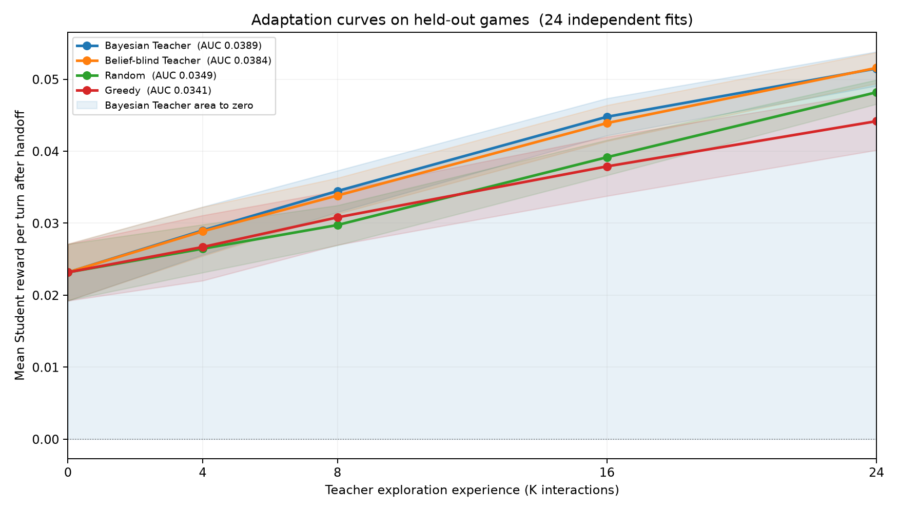

# Fast Exploration 정규 예산 결과

새 구조화 게임에서 Learned Teacher는 무작위·탐욕 탐색보다 **탐색 후 Student의 절대 적응 AUC**를 높였다. Student의 예상 보상과 불확실성을 명시적으로 받은 효과를 비가시화 Teacher와 비교한 구간은 0을 포함했다. 탐색과 평가 보상을 모두 더하면, 24턴 탐색에서 탐욕 정책의 누적 보상이 Learned Teacher보다 높았다.

3개 master seed에 8개씩 24개 독립 블록을 실행했다. 각 Teacher는 블록당 400업데이트×32게임, prior는 128게임을 사용했다. 새 시험 게임은 총 3,072개이며 각 게임 두 리셋에서 네 탐색 정책을 비교했다. 탐색 예산은 0/4/8/16/24턴, 평가는 32턴이었다. 블록 수 증가는 독립 반복의 확대다. 이전 패치의 정규 설정과 비교하면 Teacher의 블록당 400×32는 유지하고, 평가 예산과 시험 게임·리셋의 짝짓기를 바꿨다. 이전에 부분 실행한 panel과의 성능 차이를 학습량 효과로 해석하지 않는다. [프로토콜](../../fast_exploration_v1/SCALE_PROTOCOL.md)

시드별 8블록의 절대 AUC, 대응 차이, 적응 곡선과 누적 보상은 별도로 볼 수 있다. [Master seed별 결과 및 플롯](SEED_RESULTS.md)

| 탐색 정책 | 절대 AUC | 블록 간 표준편차 | K=24 후속 평균 보상 | K=24 탐색·평가 누적 보상 |
|---|---:|---:|---:|---:|
| Learned | .03889 | .00625 | .05149 | 1.4035 |
| Belief-Blind | .03844 | .00592 | .05157 | 1.4018 |
| 무작위 | .03486 | .00612 | .04818 | .9628 |
| 탐욕 | .03407 | .01015 | .04417 | 1.8072 |

K=0에서 같은 prior를 쓰는 네 정책의 시험별 보상은 정확히 일치했다. 평균 Student 보상은 .02317이었다. Learned의 K=4/8/16/24 후속 보상은 .02900/.03447/.04478/.05149였다. K=0–4 구간의 기울기는 턴당 .00146, K=16–24에서는 .00084였다. K=8에서 Learned의 평가 첫 턴 보상은 −.04257이었다. 초기 턴 성과와 32턴 전체를 평균한 AUC는 다른 질문에 답한다. [K별 곡선](evidence/adaptation_curve.csv) · [기울기](evidence/adaptation_slopes.png) · [평가 턴별 보상](evidence/assessment_reward_k8.png)

| Learned의 대응 AUC 차이 | 일반 평가 | 상대 복원·학습 동결 |
|---|---:|---:|
| − Belief-Blind | +.00045 [−.00034, +.00123] | +.00025 [−.00034, +.00086] |
| − 무작위 | +.00403 [+.00182, +.00649] | +.00484 [+.00256, +.00733] |
| − 탐욕 | +.00482 [+.00134, +.00841] | +.00067 [−.00272, +.00435] |

괄호는 master seed별 층화 대응 블록 부트스트랩의 기술적 95% 구간이다. 세 master seed에서 Learned−무작위 AUC 평균은 +.00314, +.00568, +.00327이었다. 통제 평가에서는 상대의 예열 Q를 복원하고 이후 업데이트를 정지한 뒤, 탐색으로 형성된 Student를 평가했다. 이 조건에도 무작위 대비 차이가 남았다. 탐욕 대비 차이는 불확실했다. [대응 추정치](evidence/paired.csv) · [seed별 결과](evidence/master_seeds.csv) · [블록별 AUC](evidence/block_auc.csv)

탐색 비용을 포함하면 K=24에서 Learned−탐욕의 누적 보상 차이는 −.40370 [−.71159, −.09133]이었다. 이번 Teacher 학습은 후속 보상 AUC를 목표로 한다. 이 차이는 그 지표를 개선하는 것과 첫 탐색의 비용을 포함한 합계를 최적화하는 것이 다른 정책을 선호할 수 있음을 보여 준다.

고정된 Learned Teacher에 학습 prior, pooled prior, zero prior를 연결했을 때의 AUC는 각각 .03889, .06149, .05711이었다. K=0 보상도 .02317, .04747, .03552의 차이가 있었다. 이 결과에서 기존 IPS 대리 목적을 쓴 Gaussian prior는 대조 prior보다 성과가 낮았다. 이 비교는 같은 Teacher를 다른 prior로 평가했으며 각 prior의 Teacher를 다시 학습한 결과는 별도의 실험으로 남는다. [prior 대조 결과](evidence/paired.csv)

## 후속 분석과 다음 실험

| 탐색 턴 K | Learned−탐욕 탐색 보상 | 후속 32턴 보상 차이 | 전체 보상 차이 [95% 구간] |
|---:|---:|---:|---:|
| 4 | −0.03375 | +0.07389 | +0.04014 [−0.06451, +0.15324] |
| 8 | −0.10062 | +0.11711 | +0.01649 [−0.14077, +0.18082] |
| 16 | −0.33154 | +0.22047 | −0.11107 [−0.34637, +0.13357] |
| 24 | −0.63780 | +0.23410 | −0.40370 [−0.71159, −0.09133] |

탐욕 대비 후속 보상 증가보다 탐색 비용이 더 빠르게 커졌다. K=24에서는 후속 보상 증가가 탐색에서 잃은 보상의 약 37%를 만회했다. 무작위 대비 전체 보상 차이는 양수 K 네 곳 모두 양수였다. 각 비교에서 두 정책은 같은 K와 32턴 평가 예산을 썼다. [대응 보상 분해](evidence/paired_contexts.csv)

Learned−무작위 AUC 차이는 호혜 계열에서 +.01101, 순서 +.00329, 혼합 +.00165, 자원 +.00016이었다. 호혜 계열의 점추정이 네 계열을 동일 가중한 증가분의 약 68%를 차지했다. 상대 상태를 복원한 평가에서도 호혜 계열 차이가 가장 컸다. 각 계열의 구간은 기술적이며 계열 간 차이를 직접 검정한 결과가 아니다. [계열별 대응 AUC](evidence/paired_contexts.csv)

고정된 Teacher에 pooled prior를 연결하면 무작위 대비 AUC 차이는 +.00050 [−.00085, +.00186]으로 줄었다. Belief-Blind는 보상과 상대 행동 이력을 사용하므로 명시적 Student 입력의 기여만 가려낸다. 새 실험은 **각 prior에서 Teacher를 다시 학습**하고, 전체 피드백과 피드백 차단을 비교해 탐색자가 새 게임의 경험에 맞춰 행동을 선택하는 효과를 측정한다. [v2 설계](../architecture/V2_PROTOCOL.md)

## 계산과 재현

첫 블록은 단일 CPU 작업자에서 104.4초, 이후 23블록은 8개 작업자로 554.4초였다. 두 단계 합계는 약 11분이다. 같은 단축 설정에서 배치 CPU 학습은 기존 스칼라 CPU보다 약 8.4배, 자연·통제 평가에서는 약 13.2배 빨랐다. CUDA 장치에서 코드가 동작했고, 해당 작업 단위 기준 CPU 경로가 가장 빨랐다. [패치 감사와 벤치마크](AUDIT.md) · [블록별 시간](evidence/runtime_by_block.csv)

CPU 전체 회귀 검사는 237개 중 233개 통과, CUDA 환경 의존 4개 건너뜀이었다. 별도 실제 GPU 환경에서 Fast Exploration 검사 14개가 모두 통과했다. 보존된 per-turn 원자료로 매 블록의 AUC, K별 합계, 가중치와 기록의 해시를 검증했고, 기존 스칼라 환경에서 768개 표본 궤적을 재생했다. 원 시험 패널과 prior 데이터의 직렬화 지문 중복은 0이었다. [독립 검증](evidence/final_verification.json) · [원시 해시·시드](evidence/block_manifest.json)

| 로컬 원자료 | 내용 |
|---|---|
| `runs/fast_exploration_scale_final/` | 턴별 보상 NPZ, 블록 JSON, Teacher 체크포인트, 시험별 CSV 491,520행 |
| `runs/fast_exploration_scale_actions/` | 24블록의 재생 행동 NPZ, `sample_game_002.csv`, 원자료 해시와 스칼라 재생 검증 기록 |

저장소에는 요약 결과와 플롯을 둔다. 원자료 경로를 사용해 집계와 행동 기록을 재현할 수 있다. [실행 및 재현](../architecture/README.md)
