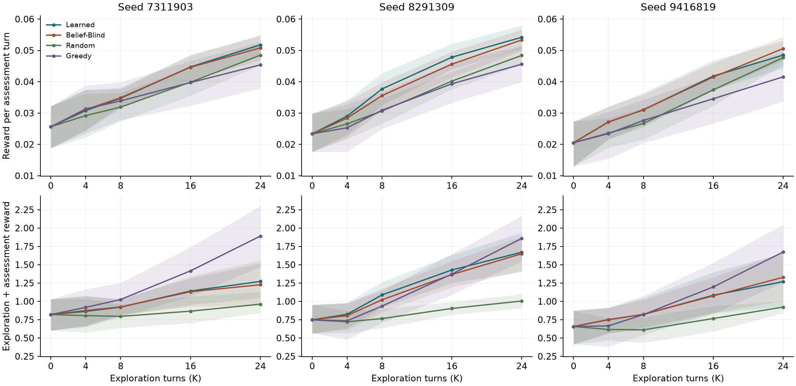

# Fast Exploration의 master seed별 결과

[기존 보고서](README.md)는 3개 master seed의 독립 학습 블록 8개씩을 합친 24블록 결과다. 아래에서는 같은 실행을 기록된 master seed에 따라 나눴다. 각 블록에서 네 정책은 새 게임 128개를 두 리셋에서 공유했다. 평가는 탐색 예산 K=0/4/8/16/24마다 32턴씩 진행했다.

## 일반 평가의 절대 적응 AUC

탐색 후 32턴의 평균 보상을 K에 대해 적분하고 최대 탐색 예산 24로 나눴다. 아래 값은 각 그룹의 블록 평균이다.

| Master seed | 블록 | Learned | Belief-Blind | 무작위 | 탐욕 | 세부 결과 |
|---|---:|---:|---:|---:|---:|---|
| 7311903 | 8 | 0.03948 | 0.03939 | 0.03635 | 0.03664 | [플롯](evidence/by_seed/seed_7311903.png) · [CSV](evidence/by_seed/seed_7311903.csv) |
| 8291309 | 8 | 0.04118 | 0.03967 | 0.03550 | 0.03461 | [플롯](evidence/by_seed/seed_8291309.png) · [CSV](evidence/by_seed/seed_8291309.csv) |
| 9416819 | 8 | 0.03601 | 0.03626 | 0.03274 | 0.03098 | [플롯](evidence/by_seed/seed_9416819.png) · [CSV](evidence/by_seed/seed_9416819.csv) |
| 통합 | 24 | 0.03889 | 0.03844 | 0.03486 | 0.03407 | [기존 통합 보고서](README.md) |

K=0의 후속 평균 보상은 시드별로 0.02562, 0.02337, 0.02053이었다. 각 시드에서 네 정책의 K=0 성과는 일치했다.

## Learned의 대응 AUC 차이

같은 블록에서 Learned의 AUC에서 각 대조 정책의 AUC를 뺐다. 괄호는 시드 내부에서 8개 블록을 20,000회 대응 재표집한 점별 95% 백분위 구간이다. 시드별 결과는 표본 8개의 변동성을 보는 기술적 분석이다.

| Master seed | Learned − Belief-Blind | Learned − 무작위 | Learned − 탐욕 |
|---|---:|---:|---:|
| 7311903 | +0.00010 [−0.00092, +0.00093] | +0.00314 [+0.00073, +0.00576] | +0.00285 [−0.00104, +0.00693] |
| 8291309 | +0.00151 [−0.00015, +0.00341] | +0.00568 [+0.00308, +0.00937] | +0.00657 [+0.00204, +0.01225] |
| 9416819 | −0.00025 [−0.00159, +0.00085] | +0.00327 [−0.00197, +0.00929] | +0.00503 [−0.00319, +0.01361] |

Learned의 무작위 대비 AUC 차이는 세 시드 모두 양수였고, `9416819`의 구간은 0을 포함했다. Belief-Blind 대비 구간은 세 시드 모두 0을 포함했다. 상대 상태를 복원하고 평가 중 학습을 동결한 통제 조건에서도 무작위 대비 차이는 세 시드 모두 양수였다.

## 적응 곡선과 누적 보상



위쪽은 탐색 뒤 Student의 턴당 평가 보상, 아래쪽은 탐색과 평가 보상을 더한 합계다. 같은 지표의 축 범위를 시드 간에 맞췄다. K=24의 평균 누적 보상은 세 시드 모두 탐욕 정책이 가장 높았다. 시드별 플롯에는 인접 K 구간의 적응 기울기와 K=8 이후 32턴의 평가 곡선도 포함했다. [시드 전체 CSV](evidence/by_seed/seed_metrics.csv)

CSV에는 일반 평가, 상대 상태 복원 및 학습 동결, pooled prior, zero prior 결과를 담았다. 각 행에 블록 평균, 블록 간 표준편차, 95% 구간을 기록했다. `assessment_turn`의 `probe_k`는 턴별 곡선을 계산한 탐색 예산이다. 2,292행의 수치를 블록 24개의 NPZ에서 직접 다시 계산해 대조했고, 24블록 AUC 평균이 기존 통합 결과와 일치함을 확인했다.

## 재현

저장소 루트에서 해당 실험의 원자료 경로를 지정한다.

```bash
.venv/bin/python -m research.fast_exploration_v1.by_seed \
  runs/fast_exploration_scale_final \
  research/fast_exploration/results/evidence/by_seed
```
