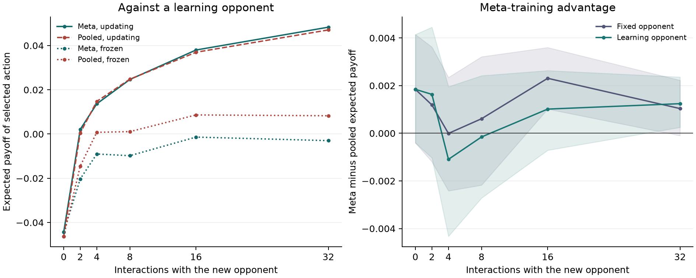

# 상대도 학습할 때, 메타학습은 새 게임에서 더 빠른 적응을 가능하게 하는가?

**새 경험을 반영하는 효과는 두 학습법 모두에서 관찰됐다. 그러나 8턴 뒤 메타학습이 일반 사전학습보다 더 나은 행동을 선택한다는 증거는 얻지 못했다.** 상대가 계속 학습할 때 두 방법의 기대 보상 차이는 −0.00015였다. 상대 학습이 메타학습의 추가 적응 이득을 바꾼 정도는 +0.00013이었다. 두 사전 지정 구간 모두 양수와 음수를 포함한다. 각 정책이 직접 24턴을 플레이한 별도 평가에서는 일반 사전학습의 평균 누적 보상이 더 높았다.



왼쪽은 상대가 학습하는 게임에서 각 시점에 선택한 행동의 기대 보상이다. 점선의 frozen 모델도 현재 관측을 받으며, 새 경험으로 계수만 업데이트하지 않는다. 오른쪽은 상대 조건별 메타학습과 일반 사전학습의 차이다. 음영은 기술적 비교를 위한 시점별 95% 블록 부트스트랩 구간이다. 사전 지정한 두 추론에는 아래의 97.5% 구간을 사용했다.

## 무엇을 바꿨는가

**상대의 학습.** 실제 구조화 게임 네 계열에서 Q학습 상대가 먼저 같은 게임을 32턴 경험하게 했다. 게임 상태를 초기화한 뒤 예열된 Q 테이블을 두 개로 복제했다. 한쪽은 계속 학습하고 다른 쪽은 Q를 고정했다. 두 상대 모두 현재 상황에 반응하며 처음에는 행동 분포가 정확히 같다. 공통 탐색 동안 두 조건에 같은 초깃값과 같은 턴별 난수를 제공했다. 상대 행동이 갈라진 뒤의 상태 차이도 상대 학습이 일으킨 효과에 포함된다.

**에이전트의 메타학습.** 한 모델은 사전학습 데이터에서 당장의 보상 예측 오차를 줄이는 초기 계수를 구했다. 다른 모델은 새 게임에서 앞선 경험으로 온라인 업데이트를 한 *뒤* 다음 보상을 잘 예측하도록 초기 계수를 구했다. 두 모델은 동일한 20개 계수, 훈련 게임, 관측, 실제 보상, 데이터량과 온라인 릿지 회귀 업데이트를 사용했다. 훈련 게임별 과거 경험을 업데이트한 상태에서 오차를 계산하는 것이 메타 목적함수의 차이다. 이 선형 모형에서는 두 목적함수를 각각 하나의 선형계로 정확히 풀 수 있다. 두 조건 모두 다음 보상이나 평가용 참 행동가치를 훈련 입력으로 받지 않는다. 자세한 식은 [실험 프로토콜](PROTOCOL.md)에 있다.

이 비교는 적은 데이터로 업데이트한 뒤 유용한 초기화를 학습한다는 아이디어를, 상대까지 반응하는 조건에서 검증한다. 기존 연구에서는 경사 기반 초기화와 변하는 경쟁자에 대한 적응을 다뤘다. 여기서는 모델 구조와 온라인 계산을 일치시키고 상대의 추가 학습만 켜거나 껐다. [Finn et al.](https://proceedings.mlr.press/v70/finn17a.html) · [Al-Shedivat et al.](https://arxiv.org/abs/1710.03641)

## 같은 경험을 줬을 때

24개 독립 블록마다 128개 훈련 게임과 128개 평가 게임을 새로 뽑았다. 총 3,072개 평가 게임 각각에 대해 0, 2, 4, 8, 16, 32턴의 공통 이력을 만들었다. 각 시점에서 후보 행동의 보상을 현재 상대의 행동 확률로 평균했다. 같은 시점의 다섯 에이전트는 정확히 같은 게임·상대 상태에 대해 평가받는다.

| 8턴 관측 후 기대 보상 | Q 고정 상대 | 계속 학습하는 상대 |
|---|---:|---:|
| 메타학습 초기화 + 온라인 업데이트 | .02417 | .02464 |
| 일반 사전학습 초기화 + 동일 업데이트 | .02356 | .02479 |
| 메타학습 초기화, 업데이트 중지 | −.01204 | −.00980 |
| 일반 사전학습 초기화, 업데이트 중지 | −.00205 | .00109 |
| 사전학습 없이 온라인 업데이트 | .01803 | .01837 |

초기 관측에서 메타학습은 −.04438, 일반 사전학습은 −.04622였다. **같은 8턴 시점**에 업데이트를 유지했을 때, 학습 상대에게 메타 모델은 .03443, 일반 사전학습 모델은 .02370을 얻었다. 메타 모델의 업데이트 이득이 더 큰 데에는 업데이트를 중지한 메타 모델의 낮은 보상도 기여한다. 실제로 업데이트한 두 모델은 같은 8턴에서 거의 같은 보상을 얻었다.

| 사전 지정한 대비 | 추정치 | 97.5% 블록 부트스트랩 구간 |
|---|---:|---:|
| 상대가 학습할 때 업데이트된 메타 모델 − 업데이트된 일반 사전학습 모델 | −.00015 | [−.00312, +.00271] |
| 메타 모델의 추가 업데이트 이득이 상대 학습으로 달라진 정도 | +.00013 | [−.00390, +.00423] |

두 번째 행은 메타와 일반 사전학습의 업데이트 이득 차이를 상대 조건 사이에서 비교한 값이다. 그 차이는 Q 고정 상대에서 .01060, 학습 상대에서 .01073이었다. 각 독립 블록의 두 대비를 보존하면서 20,000번 재표집했다. 이 결과로 두 방법의 동등성이나 모든 상대에서의 무효과를 판정할 수는 없다. [블록별 원 추정치](evidence/paired_blocks.csv) · [사전 지정 결과](evidence/primary.json)

**상대의 행동은 실제로 바뀌었다.** 두 상대의 현재 행동분포 간 평균 총변동거리는 시작 시점 0, 8턴에 .168, 32턴에 .271이었다. 이는 각 조건에서 실현된 상태에서의 분포를 비교한 수치다. 학습 조건의 Q값 절대 변화량 합계는 8턴까지 평균 .214였다. 8턴에 두 적응 모델은 학습 상대 게임의 14.3%에서 서로 다른 행동을 골랐다. 기술적 사후 분석에서 메타 모델의 세 행동 평균 기대 보상 예측 제곱오차는 .00060 낮았다. 예측 정확도가 개선되어도 선택 행동의 평균 보상 우위로 연결된다는 보장은 없다. [기술 통계와 시점별 구간](evidence/descriptive.csv)

## 직접 플레이한 결과

공통 이력 실험에서는 같은 정보를 주기 위해 탐색 행동을 고정했다. 별도 배포 평가에서는 각 모델이 처음부터 직접 행동을 고르고 업데이트했다. 게임 상태와 상대의 학습 경로도 정책마다 달라질 수 있다.

| 24턴 누적 보상 | Q 고정 상대 | 계속 학습하는 상대 |
|---|---:|---:|
| 메타학습 + 업데이트 | .833 | .839 |
| 일반 사전학습 + 업데이트 | 1.011 | 1.018 |
| 사전학습 없이 업데이트 | .703 | .729 |

학습 상대에서 메타 모델과 일반 사전학습 모델의 누적 보상 차이는 −.179였다. 기술적 95% 블록 구간은 [−.254, −.112]였다. 같은 상대의 누적 보상도 메타 에이전트와 플레이할 때 .541, 일반 사전학습 에이전트와 플레이할 때 .657로 달랐다. 이 자료는 공통 탐색에서 학습한 예측기가 스스로 선택한 상호작용을 경험할 때 성과 순위가 달라질 수 있음을 보여 준다. 그 차이의 원인을 특정 상태나 상대 유도 전략으로 식별한 실험은 아니다.

## 범위와 재현

이 결론은 3행동·기억 깊이 3의 자원·순서·상호성·혼합 게임, 예열된 Q 상대, 단기 보상을 예측하는 선형 모델에 해당한다. 고정 상대 역시 전략적으로 반응한다. 실험이 식별하는 것은 **다른 행위자의 존재 효과**가 아니라, 해당 상대가 기존 정책에서 **추가로 온라인 학습하는 효과**다. 메타학습이 언제 유용한지에 관한 이전 실험들은 [통합 연구 보고서](../REPORT.md)에 있다.

훈련에 두 방법이 공유한 focal 보상 관측은 196,608개였다. 별도 평가에서 공통 탐색 196,608턴, 직접 플레이 442,368턴을 수행했다. 상대 예열에는 전체 6,144개 게임에 걸쳐 196,608턴을 추가로 사용했다. 최종 시뮬레이션 및 결과 저장에는 이 WSL CPU에서 6개 작업 프로세스로 약 11.6초가 걸렸다. 예열 경험은 focal 모델에 제공하지 않았다. 훈련·평가 게임 사이 및 확인한 이전 패널과의 직렬화 지문 중복은 0이었다. [분할 검사](evidence/splits.json)

독립 검증은 24개 블록의 48개 초기화, 모든 공통 이력 평가 결정과 두 주 결과의 신뢰구간을 재계산했다. 또한 192개 게임의 예열과 공통 이력, 96개 게임의 여섯 배포 경로를 실제 환경에서 재생했다. 작업 프로세스 수를 6개에서 3개로 바꿔 전체를 재실행해도 72개 원자료·결과 파일의 해시가 모두 일치했다. [검증 요약](evidence/verification.json) · [파일별 SHA-256](evidence/raw.sha256)

저장소 루트에서 실행한다. 시뮬레이션과 추정에는 NumPy, 그림 생성에는 Matplotlib가 필요하다.

```bash
export PYTHONPATH=05_toy_models:.
export OPENBLAS_NUM_THREADS=1
.venv/bin/python -m unittest research.opponent_adaptation.test_data -v
.venv/bin/python -m research.opponent_adaptation.run runs/repro_opponent_adaptation --split final --workers 6
.venv/bin/python -m research.opponent_adaptation.verify runs/repro_opponent_adaptation
.venv/bin/python -m research.opponent_adaptation.describe runs/repro_opponent_adaptation runs/repro_opponent_adaptation/figures
```

원자료, 훈련 계수, 선택 행동, 두 플레이어 보상, 프로토콜과 소스 스냅샷은 `runs/opponent_adaptation_v1/`에 저장했다.
