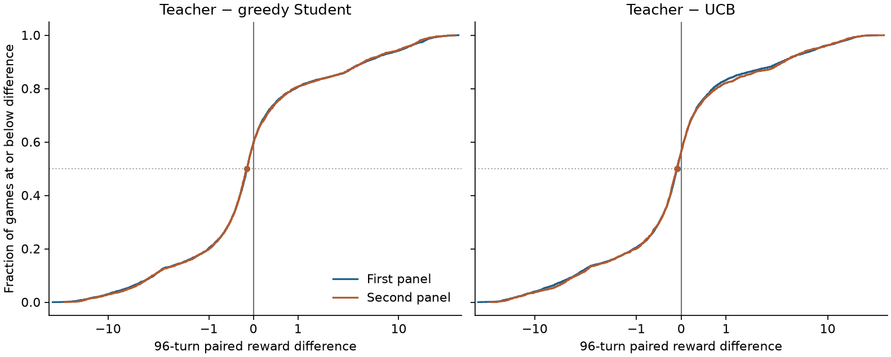
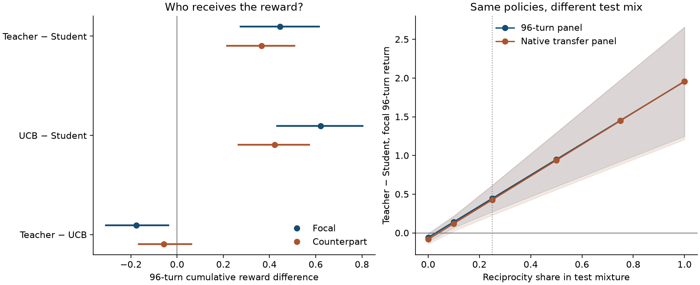

# 새 게임에서 학습된 탐색은 누구에게, 얼마나 자주 도움이 됐나?

기존 평가를 게임별로 다시 짝지어 보면, 같은 정책이 **평균 보상을 높이면서도 절반 넘는 게임에서 손해를 낼 수 있었다.** 또 첫 보상을 알면 다음 결정을 개선할 수 있는 게임은 많았지만, 그 정보를 얻기 위해 첫 행동 자체를 달리해야 했던 게임은 훨씬 적었다. 두 관찰은 평균 누적 보상만으로는 알기 어려운 적응의 서로 다른 측면이다.

등록된 15개 연구 중 10개 항목의 실행 자료 또는 게임별 정확 계산값을 다시 집계했다. 나머지 5개는 공개된 대비와 그 측정 조건을 대조했다. 모든 자료는 이미 열린 평가 세트다. 아래에 새로 계산한 수치와 기존 프로토콜에서 가져온 수치를 표시했다. [연구 목록](../project_control/studies.json)

## 1. 기대 수익과 개별 게임의 승률

같은 36개 학습 블록에서 48턴 총보상으로 훈련한 Teacher를 꺼내, 서로 다른 두 게임 패널에서 96턴 동안 평가했다. Teacher 또는 불확실성 보너스를 쓰는 UCB가 처음 8턴을 맡고, 이후 같은 방식의 탐욕적 Bayesian Student가 플레이한다. Student 단독은 첫 턴부터 탐욕 행동을 한다. 세 방법 모두 동일한 pooled prior와 학습하는 Q 상대를 사용한다. 아래는 같은 게임·초기화에서 얻은 **96턴 누적 보상**의 차이다. 게임별로 두 리셋의 차이를 먼저 평균했다. [패널별 재집계](distribution.md)

| 재계산한 지표 | 첫 패널, 4,608게임 | 후속 패널 원래 규칙, 2,304게임 |
|---|---:|---:|
| Teacher − Student 평균 | +0.446 | +0.428 |
| Teacher − Student 중앙값 | −0.144 | −0.142 |
| Teacher가 Student를 앞선 게임 | 40.1% | 40.6% |
| 양끝 5%씩 제외한 Teacher − Student 평균 | +0.110 | +0.098 |
| Teacher − UCB 평균 | −0.176 | −0.094 |
| Teacher가 UCB를 앞선 게임 | 43.5% | 43.5% |

첫 패널에서 Teacher−Student 상위 10% 게임이 전체 평균에 +1.399를, 하위 10%가 −0.909를 기여했다. Teacher의 초기 탐색 비용은 첫 8턴에 −0.188이었고, 48턴에는 +0.021 [−0.064, +0.103], 96턴에는 +0.446 [+0.274, +0.615]이었다. 후속 패널에서도 각각 −0.215, +0.025, +0.428이었다. 평균적으로는 늦게 보상을 회수했다. 두 패널에서 Teacher−UCB의 95% 구간은 각각 [−0.308, −0.038], [−0.289, +0.104]였다. 첫 패널의 UCB는 결과 공개 뒤 추가했고, 후속 패널의 UCB는 사전 지정했다. [시간별 수치와 구간](evidence/joint_returns.csv)



세로축은 가로축의 값 이하였던 게임의 비율이다. 점은 중앙값, 세로 실선은 동점이다. 가로축은 0 주변에서 선형이고 양쪽 꼬리에서 로그 간격이다. 같은 게임에서 첫 번째 리셋에 Teacher가 Student보다 높았을 때 두 번째 리셋에서도 높았던 비율은 45.9%, 44.5%였다. 두 패널은 새 게임을 따로 표집했지만 훈련 가중치는 공유한다. 36개 블록의 Teacher−Student 평균을 패널 간 비교한 상관은 −0.031 [−0.362, +0.320]이었다. 새 게임에서 분포가 비슷하더라도 어느 학습 블록이 더 좋은지 예측하는 데에는 상당한 오차가 남는다. [분포와 블록 간 상관](distribution.md)

## 2. 상대의 보상과 게임 구성

첫 패널에서 Teacher가 Student 단독을 대체했을 때 **학습하는 상대방의** 96턴 보상도 평균 +0.365 [+0.217, +0.508] 변했다. 후속 패널에서는 +0.371 [+0.210, +0.527]이었다. 두 리셋을 평균한 게임에서 두 플레이어가 모두 이익을 얻은 비율은 28.3%, 28.3%였고 양쪽 모두 손해를 본 비율은 38.1%, 37.7%였다. 평균에는 이기거나 진 횟수와 보상의 크기가 함께 반영된다. UCB로 8턴을 탐색한 경우에도 두 플레이어 각각의 평균 보상이 Student 단독보다 높았다. [두 플레이어·세 정책의 대응 수치](evidence/joint_returns.csv)

네 게임 계열을 동일 비중으로 표집한 원래 실험에서 호혜 게임의 Teacher−Student 평균은 +1.957, +1.960이었다. 그 계열 안에서도 중앙값은 −0.199, −0.139였다. 첫 패널 호혜 게임에서 공동 투자 행동의 비율은 Teacher를 썼을 때 3.06%p 높았다. 상태 방문, 보상, 상대의 학습이 함께 바뀌므로 그 행동이 얼마의 인과 효과를 냈는지는 이 궤적으로 분해하기 어렵다. [행동 및 보상 차이](evidence/joint_returns.csv) · [계열별 중앙값](evidence/distribution.csv)

관찰된 계열별 수익을 고정하고 **호혜 게임의 배치 비중만 0으로 낮춰** 나머지 세 계열을 균등 가중하면 Teacher−Student 평균은 −0.058 [−0.113, −0.002]과 −0.082 [−0.142, −0.020]이 된다. 다른 세 계열 중 하나씩을 제외하면 두 패널 모두 평균은 양수였다. 이 계산은 어떤 모집단에서 해당 평균을 기대할 수 있는지 보여준다. 훈련 게임의 비율을 바꾼 효과나 새 분포에서의 재학습 효과는 여기서 추정할 수 없다. [네 계열 전체의 재가중 결과](evidence/family_weights.csv)



## 3. 정보를 쓰는 게임과 첫 행동을 바꿔야 하는 게임

작은 게임에서는 각 첫 행동의 즉시 보상과, 두 번째 행동까지 최적으로 골랐을 때의 기대 총보상이 저장돼 있다. 이 값으로 두 질문을 나눴다. **정보 가치**는 첫 보상을 보여주면 두 턴의 최적 기대 보상이 얼마나 높아지는가이다. **첫 행동 변경 필요**는 보상을 가린 조건에서 최적인 첫 행동들을 그대로 허용했을 때, 보상을 보여주는 조건의 최댓값에 여전히 도달하는가로 판정했다. 동률인 행동 중 가장 유리한 것을 허용했고, 두 조건 모두 상대 행동과 공개 상태를 본다. [정확 계산 프로토콜](../structured_oracle/PROTOCOL.md) · [재계산 코드](oracle.py)

| 실행 가능한 규칙 두 개 중 하나가 숨겨진 상황 | 규칙 쌍 | 첫 보상이 유용 | 첫 보상을 볼 수 있어 최적 첫 행동을 반드시 바꿔야 함 |
|---|---:|---:|---:|
| 3행동, 이력 깊이 1 | 96 | 75 | 11 |
| 3행동, 이력 깊이 3 | 96 | 73 | 12 |
| 6행동, 이력 깊이 5 | 96 | 62 | 6 |

가장 큰 설정에서는 62쌍에서 보상 관측에 가치가 있었고, 그중 56쌍에서는 보상을 가려도 선택할 수 있었던 최적 첫 행동으로 그 가치를 전부 얻을 수 있었다. 이 패널에서는 행동 수와 명목상 이력 깊이가 함께 증가했다. 두 턴이라는 짧은 지평, 두 후보 규칙을 아는 oracle, 잡음 없는 보상 관측도 결과에 영향을 준다. 세 설정은 같은 생성 시드를 공유한다. 표의 열은 학습된 Teacher가 실제로 정보를 알아냈을 확률을 추정하지 않는다. [계열별 분해 및 첫 행동을 고정할 때의 손실](evidence/oracle.csv)

학습 정책에 대해서는 별도의 통제 결과가 있다. v2 주 시험에서 경험을 보고 다음 탐색 행동을 정하는 Teacher의 후속 절대 AUC는 피드백 차단 Teacher보다 +0.00097 [+0.00037, +0.00159] 높았다. 같은 지표에서 UCB와의 차이는 −0.00938이었다. 새 동역학 패널에서는 공동 투자 성공 확률을 0.6 낮췄을 때 K=8 후속 피드백 이득의 변화가 턴당 −0.00012 [−0.00168, +0.00142]였다. 96턴 총보상용 Teacher와 여기서 후속 AUC를 목표로 한 Teacher는 별도로 학습했다. [기존 v2 대조 결과](../fast_exploration/results/v2/README.md) · [동역학 개입](../dynamics_transfer/REPORT.md)

## 4. 메타학습의 이득이 생기거나 사라진 조건

| 이번에 다시 계산한 비교 | 관측 | 해석에 필요한 조건 |
|---|---|---|
| 같은 경험을 받은 메타 초기화와 일반 사전학습 | 학습 상대와의 3,072게임에서 8턴 후 선택 행동이 달랐던 비율은 14.32%. 전체의 7.06%에서 메타 쪽, 7.10%에서 일반 사전학습 쪽 기대 보상이 높았다. 평균 차이는 −0.00015. | 탐색 이력, 상대 상태, 온라인 업데이트를 맞췄다. 별도 24턴 직접 플레이에서는 메타 쪽 누적 보상이 −0.179 [−0.253, −0.112] 낮았다. 호혜 계열에서 차이가 −0.718로 가장 컸다. [행동·계열별 비교](earlier.md) |
| 한 맥락에서 관측하고 다른 맥락에서 결정 | 상대의 숨은 선호가 같은 게임에서 학습 prior − 독립 prior는 +0.181, 반대인 게임에서 −0.272. 32개 블록 모두 각 조건의 부호가 같았다. | 0턴 결정이 같아 관측을 통한 전이를 분리할 수 있다. 일치율 75%로 가중하면 +0.068, 50%면 −0.045다. 조건별 점추정치의 손익분기점은 약 60%다. [맥락별 결과](earlier.md) |
| 무작위로 동일하게 탐색한 후 IPS prior − 일반 pooled prior | 32턴 후속 평균 보상 차이가 v1에서 K=0의 −0.0243에서 K=24의 −0.0241로, v2에서 −0.0274에서 −0.0232로 변했다. | 두 버전 모두 차이의 변화 구간에 0이 포함됐다. v2에서 상대를 복원하고 두 학습자를 동결한 평가에서는 격차가 오히려 0.0151 [0.0085, 0.0213] 커졌다. 어떤 prior를 썼는지, 평가 중 학습을 허용했는지가 모두 중요하다. [prior별·계열별 대비](evidence/prior.csv) |
| D-031 탐색 보상 목표 P와 무작위 | K=0을 기준으로 한 적응 AUC의 P−무작위는 전체 +0.01585 [+0.00537, +0.02787], 경쟁 계열 −0.01901 [−0.02967, −0.00932]. 경쟁 규칙 16개 중 P가 앞선 규칙은 2개. | 25개 학습 조합이 같은 64개 규칙을 평가했다. 구간은 훈련 조합과 계열 내 공통 시험 규칙을 함께 재표집했다. 후속 성능을 학습한 M도 경쟁 계열에서 무작위보다 0.01191 낮았다. [상대별·예산별·정책별 결과](d031.md) |
| 두 턴 누적 보상과 즉시 보상으로 학습한 첫 행동 | 두 정책의 행동은 31.46%의 상태에서 달랐다. 두 턴 기준 전체 상태의 15.19%에서 누적 목표가 앞섰고 14.93%에서 즉시 목표가 앞섰다. 평균은 누적 목표가 +0.00638이었다. | 보상의 크기가 승패 횟수와 별도로 작용했다. 호혜 계열의 양의 기여가 전체 평균 차이보다 컸다. [두 턴 분해](earlier.md) |

호혜라는 이름이 같아도 96턴 Teacher와 탐욕 Student를 비교하면 큰 양의 평균이, 24턴 메타 초기화와 일반 사전학습을 비교하면 큰 음의 평균이 나왔다. 각 실험은 평가 예산, 정책, 학습 목표, 게임 표본이 다르다. 이 데이터에서 특정 계열이 보편적으로 메타학습에 유리하다는 결론을 내리기는 어렵다.

## 5. 다른 다섯 연구와의 대조

아래는 기존에 공개된 연구별 결과다. 실험마다 보상 단위와 비교 대상이 달라 합산 효과를 계산하지 않았다.

| 연구 | 관찰된 결과 |
|---|---|
| 구조화 게임 전이 | 공통 0→8턴 경험 후 기대 보상의 개선량은 혼합 계열 empirical Bayes에서 scratch보다 0.0151 작았다. 별도 32턴 직접 플레이의 평균은 각각 0.992와 0.889였다. [기존 보고](../structured_transfer/REPORT.md) |
| 행동 수와 이력 깊이 확대 | 6행동·깊이 5에서 8턴 후 empirical Bayes − pooled는 +0.00376 [+0.00071, +0.00702]. 16턴의 평균 순위는 뒤바뀌었다. [기존 보고](../structured_scale/REPORT.md) |
| 규칙 유사도 | D-031 계열 내 전략 유사도와 M 자신의 AUC 순위 상관은 +0.241, M−P와는 −0.203. 구조화 게임에서 일반 사전학습 대비 추가 이득과 보상·전이 유사도 상관은 −0.008 [−0.042, +0.025]. [기존 분석](../rule_similarity/REPORT.md) |
| 두 턴 탐색 행동 학습 | 즉시 보상 정책 대비 두 턴 보상은 +0.00356. 환경과 상대를 복원한 상태에서 탐색 정책 특화와 보상 공개 여부의 상호작용은 +0.00063, 사전에 정한 97.5% 구간은 [−0.00015, +0.00167]. [기존 보고](../active_probe/REPORT.md) |
| 후속 보상 가중치 | 후속 보상 가중치 8에서 보상 신호를 뒤섞는 개입에 대한 두 탐색 정책의 민감도 차이는 +0.001883. 실제 신호로 얻은 가중 총보상은 두 정책 0.2150, 0.1990, 즉시 보상 정책 0.2227이었다. [기존 보고](../probe_stakes/REPORT.md) |

훈련 다양성에 대해서도 D-031의 기존 완료 결과가 범위를 한정한다. 동일 훈련 예산에서 규칙을 8개에서 128개로 늘리자 M−P가 0.01017 낮아졌다. M 자체 평균은 0.10439에서 0.10292로, P는 0.11037에서 0.11908로 변했다. 규칙 수가 늘어날 때 규칙당 노출도 함께 줄었다. 이 비교만으로 게임 수·전략적 다양성·노출의 효과를 각각 식별할 수 없다. [D-031 완료 결과](../d031_completion/README.md)

## 검증과 재현

각 분석은 짝지은 평가 단위를 유지했다. Fast Exploration은 master seed 안에서 학습 블록을, 이전 초기화 연구들은 독립 학습 블록을, D-031은 카탈로그와 카탈로그 안 학습 반복을 재표집했다. D-031의 계열 비교에는 공유 규칙 재표집도 포함했다. 95% 구간은 해당 표집 방식 아래의 기술적 불확실성이며, 여러 지표와 계열을 검토한 데 대한 동시 보장은 없다. 두 리셋의 게임별 승률에는 초기화와 상대 행동의 변동이 남는다. 보고서 사이의 조건부 구간 끝자리는 재표집 난수에 따라 조금 다를 수 있다. Oracle의 유한 패널 집계는 정확 계산이며 구간을 붙이지 않았다.

NPZ·모델의 원래 영수증, D-031의 150개 정책 평가 영수증, 첫 D-031 블록의 여섯 정책 원시 반복을 확인했다. 별도 구현으로 두 플레이어의 96턴 보상, 계열 재가중, prior의 K별 차이, D-031 경쟁 계열, 과거 24턴 배치의 핵심 수치를 재계산했다. Oracle은 버전 관리된 행동별 값에서 세 기존 지표를 복원했다. 첫 행동 변경 필요 횟수는 두 조건의 최적 행동 집합이 서로 겹치는지 검사하는 별도 계산과 15개 행 모두 일치했다. 여섯 분석을 다시 실행해 10개 CSV와 두 그림의 SHA-256이 모두 동일함을 확인했다.

저장소 루트에서 아래 명령으로 여섯 분석을 다시 실행한다. Oracle은 저장소에 포함된 게임별 자료만으로 재현할 수 있다. 다른 분석은 해당 연구의 원본이 로컬 `runs/`에 있어야 하며, 원본 생성 명령은 [연구 목록](../project_control/studies.json)에 있다. 수치표·블록별 자료·그림은 [evidence](evidence/)에 있다.

```bash
export PYTHONPATH=05_toy_models:.
export OPENBLAS_NUM_THREADS=1 OMP_NUM_THREADS=1
for analysis in oracle distribution joint_returns prior earlier d031
do
  .venv/bin/python -m "research.retrospective.$analysis" || exit 1
done
```
