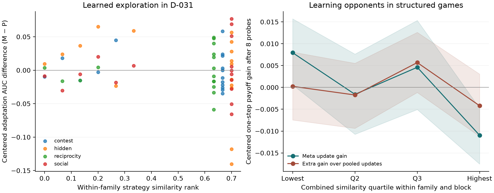

# 훈련 게임과 규칙이 비슷하면 탐색 뒤에 더 잘 적응하는가?

현재 자료에서 **훈련 규칙과 가까울수록 메타 탐색의 추가 이득이 커진다는 방향은 확인되지 않았다.** D-031의 정규 예산 결과 한 쌍에서 그 상관은 작고 음수였다. 독립적으로 훈련된 24개 블록의 구조화 게임에서는, 훈련과 덜 비슷한 게임에서 관측을 활용한 보상 개선 폭이 조금 더 컸다. 일반 사전학습도 같은 온라인 업데이트를 했을 때 생긴 이득을 빼면, 유사도와 메타학습의 추가 이득 사이의 구간은 0을 포함했다.



왼쪽은 D-031 탐색 정책 비교다. 점마다 새 게임 한 개를 나타내며, X축은 게임 계열 내 전략 유사도 순위다. 오른쪽은 구조화 게임의 공통 탐색 이력 비교다. 학습 블록·게임 계열 안에서 보상과 전이의 합성 유사도를 사분위로 나누고, 해당 블록·계열의 평균 대비 보상 차이를 표시했다. 음영은 기술적 사분위별 95% 블록 구간이다.

## 학습된 탐색 정책 비교

D-031은 훈련 게임에서 최적이던 3턴 대응 전략을 평가 게임에 옮겼을 때의 보상 손실을 유사도 지표로 사전 지정했다. 균등·복사 상대를 각각 사용하고, 훈련 규칙과 공통 행동 재명명 중 손실이 최소인 조합을 구한다. 그림과 아래 표는 이 손실에 음수를 붙여 높은 값이 높은 유사도를 가리키도록 했다. 보상표 유사도도 별도로 계산했다. 두 플레이어의 보상 텐서에 대해 공통 행동 재명명 여섯 개를 적용하고 32개 훈련 게임 중 최소 RMSE를 구했다.

완료된 첫 훈련 카탈로그·반복의 미학습 게임 64개를 사용했다. 게임마다 같은 상대 두 종류와 시드 여덟 개를 짝지어, 탐색 0/3/6/12/24턴 후 학생 보상의 적응 곡선을 원자료에서 다시 적분했다. 총 1,024개 시험·상대·시드 조합을 비교했다. M은 후속 학생의 적응을 목표로 훈련한 탐색 정책이고 P는 직접 보상을 목표로 훈련한 탐색 정책이다. 게임 계열별 Spearman 상관 네 개의 평균을 보고한다.

| 훈련 게임과의 유사도 | M−P 적응 면적 | M−무작위 탐색 적응 면적 | M 자체의 적응 면적 | M의 학생 Q 보존 이득 면적 |
|---|---:|---:|---:|---:|
| 전략 전이 손실의 음수 | −.090 | +.003 | +.050 | +.041 |
| 보상 함수 거리의 음수 | −.067 | −.104 | +.060 | +.121 |

전략 유사도와 M−P의 상관은 계열별로 contest −.175, hidden −.308, reciprocity +.008, social +.113이었다. 전략 손실이 같은 게임에는 평균 순위를 줬다. 같은 64개 게임을 평가한 훈련 카탈로그·반복은 하나다. 이 수치는 그 카탈로그의 패널 내 기술 통계다. 평가 시행을 독립적으로 학습된 정책으로 세어 구간을 좁히지 않았다. M−P는 탐색자가 바꾼 경험과 상대의 후속 상태를 함께 반영한다. Q 보존 이득은 같은 탐색 직후 학생의 Q값을 보존하거나 지우고 평가한 보상 차이 G를 탐색 예산에 따라 적분한 값이다. [게임별 값과 상관](evidence/d031_games.csv) · [계열별 결과](evidence/d031_correlations.csv) · [원래 프로토콜](../../04_design/Adaptation_Experiment.md)

## 구조화 게임에서 경험을 반영하는 능력

24개 독립 훈련 블록의 새 게임 3,072개를 사용했다. 각 게임에서 같은 무작위 탐색 8턴 뒤, 같은 게임·학습 상대 상태를 기준으로 비교했다. 첫 결과는 메타 초기화에서 8턴의 관측에 따라 업데이트했을 때 얻은 보상에서 계수를 초기값으로 고정했을 때의 보상을 뺀 차이다. 두 번째 결과는 그 이득에서 일반 사전학습 초기화의 동일한 업데이트 이득을 뺀 차이다.

보상과 상태 전이를 함께 보는 분석에서는, 공통 이력·상태·행동 조합 여섯 개에 대해 두 플레이어의 보상과 기대 다음 상태를 계산했다. 모든 공통 행동 이름 변경을 확인하고 같은 계열의 훈련 게임 중 가장 가까운 것을 선택했다. 상태의 각 좌표에서 차이를 2로 나눈 뒤 보상 거리와 제곱합했다. 이 조합에는 실제 플레이에서 도달하지 않는 상태도 포함된다. 따라서 합성 거리의 수치는 이 여섯 진단 조건과 거리 가중치에 의존한다. 계열 안에서 상태 전이 서명의 최근접 거리가 모두 0이어서, 전이 유사도만으로는 상관을 계산할 수 없었다.

| 유사도 지표 | 8턴 관측을 반영한 메타 모델의 이득과 Pearson 상관 | 일반 사전학습 대비 추가 이득과 Pearson 상관 |
|---|---:|---:|
| 두 플레이어 보상 | −.037 [−.071, −.002] | −.013 [−.049, +.021] |
| 보상과 기대 상태 전이 | −.042 [−.072, −.012] | −.008 [−.042, +.025] |
| 초기 상태 focal 보상표만 사용한 민감도 분석 | −.024 [−.057, +.009] | — |

블록과 게임 계열 안에서 상관을 계산한 뒤 블록을 다시 표집해 기술적 95% 구간을 구했다. 보상 유사도가 낮은 게임에서 업데이트가 더 큰 도움을 주는 경향은 관찰됐다. 그 크기는 작으며, 업데이트 전 정책이 개선할 여지가 더 컸는지와 유사도 자체의 효과를 구분하지 못한다. 관측 이력은 공통 무작위 행동에서 생겼으므로 이 표는 **정보를 얻는 행동 선택**보다 **주어진 정보를 사용하는 능력**에 관한 결과다. 두 분석 모두 이미 열린 평가 패널의 상관이다. 훈련 배치에 특정 종류의 게임을 더 넣으면 적응이 얼마나 개선되는지는 별도의 개입이 필요하다. [동적 유사도 결과](evidence/structured_dynamic_summary.json) · [블록·계열별 상관](evidence/structured_dynamic_strata.csv) · [직접 비교 프로토콜](../opponent_adaptation/PROTOCOL.md)

게임 유사성을 이용해 평형에 더 빠르게 수렴하는 이론 연구도 있다. 여기서 측정한 결과는 제한된 탐색 뒤 특정 학습 상대에게 얻는 보상이므로 두 결과의 지표와 조건이 다르다. [Mao et al.](https://proceedings.neurips.cc/paper_files/paper/2023/hash/d1b1a091088904cbc7f7faa2b45c8f36-Abstract-Conference.html) · [Harris et al.](https://arxiv.org/abs/2209.14110)

## 재현

저장소 루트에서 실행한다. 마지막 명령은 그림을 만든다.

```bash
export PYTHONPATH=05_toy_models:.
export OPENBLAS_NUM_THREADS=1
export MPLCONFIGDIR=/tmp/mamrl_plot
.venv/bin/python -m research.rule_similarity.d031 runs/d031_v2 runs/repro_similarity_d031 --verify-strategy-loss
.venv/bin/python -m research.rule_similarity.structured
.venv/bin/python -m research.rule_similarity.dynamics
.venv/bin/python -m research.rule_similarity.figure runs/repro_similarity_d031 runs/rule_similarity_dynamics runs/repro_similarity.png
```

이어지는 정규 예산 실행과 완료 집계는 [D-031 재개 기록](../d031_completion/README.md)에 있다. 보상 신호를 교란한 상태에서 첫 행동 선택을 비교하기로 했던 기존 계획도 4,096개 새 게임에서 실행했다. 후속 보상에 8배 가중치를 주었을 때 특화 탐색의 신호 의존도 차이는 +.00188 [+.00080, +.00294]였다. 이 조건에서도 실제 신호가 주어진 전체 가중 보상은 즉시 보상 최대화 첫 행동이 더 높았다. [실험 보고서](../probe_stakes/REPORT.md)
